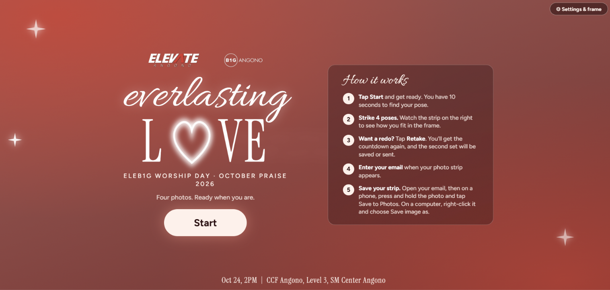

# 📸 Event Photobooth

A kiosk photobooth for live events. Guests take a multi-shot photo strip, and it is emailed to them automatically, even when the venue Wi-Fi drops.



## Overview

Event venues often have unreliable internet. A photobooth that sends photos straight to email fails exactly when guests are watching.

This app saves every session to local disk first, then sends emails from a background queue that retries until they go through. The guest never waits on the network.

Built for weddings, church gatherings, and other live events.

## Key features

- **Multi-shot capture:** the webcam takes a sequence of shots and combines them into a strip using a transparent frame image. **[VERIFY: composed in the browser with Canvas]**
- **Offline-safe email queue:** a background worker retries failed sends every 30 seconds.
- **Session logging:** each guest session gets its own folder with a `session.json` file, and addresses are logged to `emails.csv`.
- **Swappable frames:** upload a new overlay frame from the kiosk UI, no code change needed.
- **Kiosk-ready:** runs full-screen in Chrome on a standalone machine.

## Tech stack

| Layer | Tools |
| --- | --- |
| Server | Node.js 20.6+, Express 4 |
| Email | Nodemailer over SMTP (Gmail app password or Brevo) |
| Storage | File system: JSON session files and a CSV log |
| Front end | HTML, CSS, JavaScript, Canvas API, `getUserMedia` |

## Architecture and design decisions

```text
Browser (kiosk)                         Node/Express server
┌──────────────────────┐   POST /api/session   ┌──────────────────────────┐
│ webcam → capture     │ ────────────────────▶ │ decode base64 → sessions/│
│ compose strip        │                       │ write session.json       │
│ (frame from /frame)  │ ◀──────────────────── │ append to emails.csv     │
└──────────────────────┘      { ok }           └────────────┬─────────────┘
                                                            │ every 30 s
                                                  ┌─────────▼─────────┐
                                                  │ flush(): send via │
                                                  │ SMTP, retry later │
                                                  └───────────────────┘
```

- **Disk first, network second.** Writing to disk before emailing means a network failure can't lose a guest's photos.
- **Background retry loop.** A `setInterval` worker (`flush()`) is separate from the request path, so slow or failed email never blocks the kiosk.
- **Plain files instead of a database.** One machine and one event don't need a DB, and the output is easy to inspect or copy off the laptop.
- **Base64 over JSON.** Images travel as base64 and are decoded with `Buffer`. This keeps the API simple, with the request body limit raised to handle photo sizes.
- **Frame is a replaceable file.** `/frame.png` serves your uploaded frame, or falls back to a default.

## Quickstart

**Requirements:** Node.js **20.6 or newer** (the start script uses `--env-file`), and Chrome.

```bash
git clone https://github.com/athensofgreece/event-photobooth.git
cd event-photobooth
npm install
cp .env.example .env     # then fill in your SMTP details
npm start
```

Open `http://localhost:3000`. For a real event, run Chrome full-screen:

```bash
chrome --kiosk http://localhost:3000
```

Without SMTP settings the app still runs. It just logs that email is not configured.

### Configuration (`.env`)

| Variable | Example | Purpose |
| --- | --- | --- |
| `SMTP_HOST` | `smtp.gmail.com` | Mail server |
| `SMTP_PORT` | `587` | Mail port |
| `SMTP_USER` | `yourbooth@gmail.com` | Sender login |
| `SMTP_PASS` | `your-app-password` | Gmail needs an app password with 2-Step Verification on |
| `MAIL_FROM` | `"Our Photobooth <yourbooth@gmail.com>"` | From line |
| `MAIL_SUBJECT` | `Your photobooth pictures!` | Subject line |

## Project structure

```text
├── server.js        # Express server, API routes, background email queue
├── public/          # Kiosk UI, fonts, default frame
├── data/            # Active overlay frame (frame.png)
├── sessions/        # Created at runtime: guest folders and emails.csv
├── .env.example     # Config template
└── package.json
```

## Known limitations

- Designed for one trusted kiosk on a local machine. The API has no authentication, so don't expose it to the internet.
- Port 3000 is fixed in code. **[VERIFY / consider `process.env.PORT`]**
- No automated tests yet.

## Roadmap

- [ ] Add `PORT` and email-retry limits to `.env`
- [ ] Add tests for the email queue's retry behavior
- [ ] Split `server.js` into routes, queue, and storage modules
- [ ] Optional print or QR-code download for guests

## License

MIT
